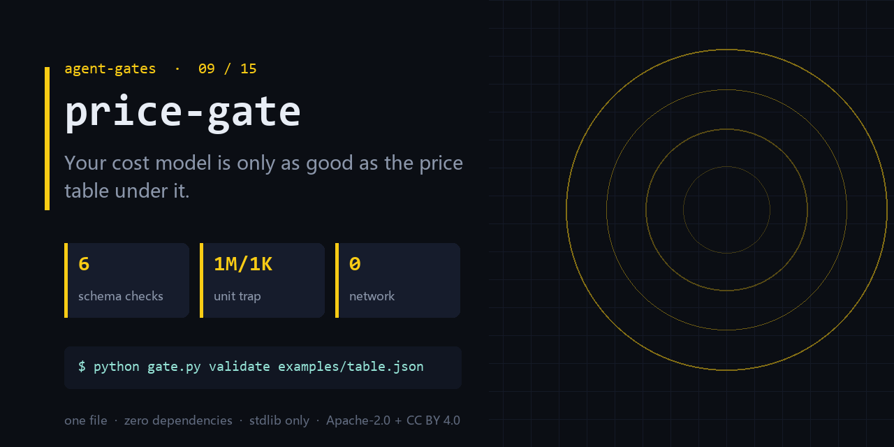

<div align="center">

</div>

<h1 align="center">price-gate</h1>

<p align="center"><b>Your cost model is only as good as the price table under it.</b><br><sub>one file · zero dependencies · stdlib only</sub></p>

<p align="center"><a href="https://github.com/chenhz01/price-gate/actions/workflows/gate.yml"></a>   </p>

---

## The failure this catches

- ROI was computed from a price table copied three months ago; the real bill doubled.
- One row is per 1K tokens, another per 1M — the estimate is off by 1000x.
- Prices are hand-copied with no currency and no effective date, so nobody dares edit the file.

One command, on a file you already have:

```bash
python gate.py validate examples/table.json
```

<details>
<summary><b>Real output</b> — produced by the bundled <code>examples/</code>, not a mock-up</summary>

```text
error R8 $.models[4].effective_from: effective_from must be YYYY-MM-DD
1 error(s), 0 warn(s)
```

</details>

## What it does

- Checks schema, unit consistency, currency, and effective dates across rows.
- Catches the 1K/1M unit drift that silently multiplies your cost estimate.
- Ships a throughput bench so a 10k-row table stays cheap to validate.

## What it does **not** do

- It does not fetch live prices. It validates the table you decided to trust.
- It cannot tell you which provider is cheaper — that depends on your traffic mix.
- A valid table can still be wrong; validity is not truth.

Being explicit here is cheaper than a wrong expectation later.

## Exit codes

`0` = clean, `1` = findings. Gate your pipeline on `$?`.

## Install

```bash
git clone https://github.com/chenhz01/price-gate
cd price-gate
python gate.py --help
```

Python 3.9+. Nothing to `pip install` — stdlib only.

## Use it in CI

```yaml
- name: price-gate
  run: python gate.py validate examples/table.json
```

## Use it as a GitHub Action

`action.yml` is included, so you can call this repo directly as a composite action.

```yaml
# .github/workflows/gates.yml
- uses: actions/checkout@v4

- uses: chenhz01/price-gate@v0.1.0
  with:
    # IMPORTANT: this path is inside YOUR repository.
    # The examples/ in this repo are NOT in your workspace — pass your own files.
    args: "validate path/to/table.json"
```

Pin the tag (`@v0.1.0`) rather than `@main` — `main` moves.

If you omit `args`, the action only prints help and exits 0. It raises a warning
annotation so a green check is never mistaken for "it inspected my files".


## 中文速览

**价格表门** — 你的成本模型，上限取决于底下那张价格表对不对。

- 按三个月前抄的价格算 ROI，真实账单翻了一倍。
- 同一张表里，一个按 1K tokens 计价，一个按 1M，算出来差 1000 倍。
- 价格表是手抄的，没有币种、没有生效日期、没有缓存价，谁也不敢改。

一行命令：`python gate.py validate examples/table.json`

边界：It does not fetch live prices. It validates the table you decided to trust.

## The gates

| # | gate | what it stops |
|---|---|---|
| 02 | **[loop-gate](https://github.com/chenhz01/loop-gate)** | Find where your agent looped, before it burns another run |
| 03 | **[permission-gate](https://github.com/chenhz01/permission-gate)** | Score how much more your agent can do than it should |
| 04 | **[context-gate](https://github.com/chenhz01/context-gate)** | Measure what truncation deletes, before the model starts guessing |
| 05 | **[instruction-gate](https://github.com/chenhz01/instruction-gate)** | Two of your instructions contradict each other. This finds them |
| 06 | **[output-gate](https://github.com/chenhz01/output-gate)** | Before AI-written text ships, run the four checks it always fails |
| 07 | **[memory-expiry-gate](https://github.com/chenhz01/memory-expiry-gate)** | Give every memory a TTL, then prove the expiry semantics actually hold |
| 08 | **[drift-gate](https://github.com/chenhz01/drift-gate)** | When embeddings drift, retrieval quietly rots. Fingerprint it |
| 09 | **price-gate** ← you are here | Your cost model is only as good as the price table under it |
| 10 | **[complexity-ceiling](https://github.com/chenhz01/complexity-ceiling)** | Per-file complexity budgets that fail the build instead of the reviewer |
| 11 | **[deadcode-gate](https://github.com/chenhz01/deadcode-gate)** | Quantify how much of the repo is dead, instead of guessing |
| 12 | **[docrot-gate](https://github.com/chenhz01/docrot-gate)** | Docs don't die at once. They rot one stale command at a time |
| 13 | **[leak-gate](https://github.com/chenhz01/leak-gate)** | Scan for internal detail before the doc leaves the building |
| 14 | **[backup-gate](https://github.com/chenhz01/backup-gate)** | A backup you have never verified is a rumor |
| 15 | **[trail-gate](https://github.com/chenhz01/trail-gate)** | Hash-chained agent audit trail — and it verifies its own chain |

## License

- Code: **Apache-2.0** — see [LICENSE](LICENSE)
- Docs and example data: **CC BY 4.0** — see [LICENSE-SPEC](LICENSE-SPEC)

Attribution required when you redistribute the documentation; code can be used commercially
without a separate agreement. See [NOTICE](NOTICE).
